 

## Hi, I'm Rjhay (or Jae)

Computer engineer from Leyte. I build software and hardware, from web and mobile apps to AI models and microcontrollers, and I like taking an idea all the way from a rough sketch to something people can actually use. Most of my free time goes into side projects, small games and learning whatever I need to finish the next one.

- **Applied AI**: computer vision (YOLOv8/v11, X3D), LLM integration, workflow automation (n8n)
- **Full stack, every layer**: embedded (ESP32, PIC16F84A) → backend (FastAPI, Spring Boot, Supabase) → frontend (React/Next.js) → mobile (Flutter, React Native)

 

## Things I've built

| Project | What it is |
|---|---|
| [**EcoVision Security Sentinel**](https://github.com/unknowndevice077/ecovision-crime-detection-ai) | AI crime detection for barangay CCTV. Catches 88% of fights at about 2 false alarms an hour on real street footage |
| [**Bantay Baha**](https://github.com/unknowndevice077/bantay-baha) · [live](https://embeddedbantaybaha.vercel.app) | ESP32 flood early warning with a 3D simulator, a story game and a storm-surge coastal mode |
| [**MedNotes E-Library**](https://github.com/unknowndevice077/MedNotes-E-Library) · [live](https://unknowndevice077.github.io/MedNotes-E-Library/) | Paid e-library for medical study files on web and Android, with device limits and traced PDFs |
| [**QueueUp**](https://github.com/unknowndevice077/queueup) | Booking and walk-in queue SaaS for clinics, barbers and salons, with a "Now Serving" TV board |
| [**jaemboy**](https://github.com/unknowndevice077/jaemboy) | ESP32 handheld console running a Doom-style raycaster, controlled from your phone |

More on the [portfolio](https://jae-portfoliooo.vercel.app), plus 9 browser games with leaderboards on the [play page](https://jae-portfoliooo.vercel.app/play). Come beat my score.

 

## Stack

 

## Meanwhile, a snake is eating my commits

<picture>
  <source media="(prefers-color-scheme: dark)" srcset="https://raw.githubusercontent.com/unknowndevice077/unknowndevice077/output/snake-dark.svg" />
  
</picture>

